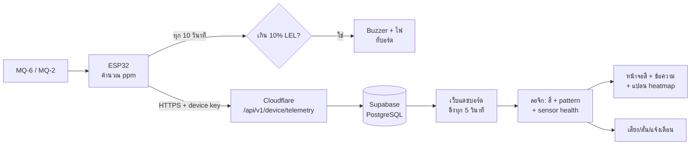

# GasGuard — ร่างเกณฑ์ ลอจิก และ Flow (ให้ทีมตรวจก่อนใช้จริง)

> สถานะ: **ร่าง** ตัวเลขในเอกสารนี้ตั้งไว้ในโค้ดแล้ว (`js/safety-logic.js`) แต่ทีมต้องตกลงร่วมกัน
> และฝั่งฮาร์ดแวร์ต้องตั้ง buzzer ให้ตรงกัน

## 1. เกณฑ์ค่าแก๊สของแต่ละสี

ใช้ค่า LEL ของ LPG = **1.8 %vol = 18,000 ppm**
- ค่านี้มาจากบิวเทน ซึ่งต่ำกว่าโพรเพน (2.1 %vol) จึงปลอดภัยกว่า
- ดังนั้น 1 %LEL = 180 ppm

| สี | ระดับ | ppm | %LEL | ข้อความหลักบนจอ |
|---|---|---|---|---|
| 🟢 เขียว | ปกติ | ต่ำกว่า 900 | < 5% | ปลอดภัย จุดเตาได้ |
| 🟡 เหลือง | เฝ้าระวัง | 900 – 1,799 | 5–10% | เริ่มมีแก๊สสะสม ให้ระบายอากาศ |
| 🟠 ส้ม | เตือน | 1,800 – 3,599 | 10–20% | ห้ามเปิด-ปิดสวิตช์ไฟ ปิดวาล์วถังแก๊ส |
| 🔴 แดง | อันตราย | ตั้งแต่ 3,600 | ≥ 20% | รีบอพยพออกจากพื้นที่ทันที |

**ที่มาของตัวเลข**
- เครื่องตรวจแก๊สทั่วไปตั้งเตือนล่วงหน้าที่ 10 %LEL และเตือนหลักที่ 20 %LEL
- เครื่องเตือน LPG ในบ้านตามมาตรฐาน EN 50194 ส่วนใหญ่เตือนในช่วง 10–20 %LEL
- เราเพิ่มสีเหลืองที่ 5 %LEL เพื่อให้รู้ตัวเร็วขึ้น และให้ระบายอากาศก่อนถึงขั้นตัดวาล์ว

**ข้อควรระวัง**
- ค่า ppm จาก MQ-6 / MQ-2 เป็นค่าประมาณจากกราฟใน datasheet ยังไม่ได้เทียบกับแก๊สมาตรฐาน
- ในเล่มต้องเขียนข้อจำกัดนี้ด้วย

## 2. Pattern: สะสมต่อเนื่อง vs รั่วกระชาก

| Pattern | เงื่อนไข (ร่าง) | ระบบทำอะไร |
|---|---|---|
| **รั่วกระชาก (spike)** | ค่าขึ้น ≥ 900 ppm (5 %LEL) ภายใน 15 วินาที (เทียบกับค่าก่อนหน้า 1 รอบ) | **เตือนเร็วขึ้น 1 ระดับ** เช่น ค่าจริงอยู่สีส้ม → ขึ้นสีแดง |
| **สะสมต่อเนื่อง** | ใน 5 นาทีล่าสุด ค่าเพิ่ม ≥ 90 ppm/นาที และ ≥ 70% ของการอ่านเป็นขาขึ้น | ถ้ายังเขียว → ขึ้น **เหลือง** ให้ระบายอากาศก่อน |
| ค่ากำลังลดลง | ลด ≥ 90 ppm/นาที | แสดงว่า "ค่ากำลังลดลง" |
| ค่าคงที่ | ไม่เข้าเงื่อนไขข้างบน | — |

## 3. Sensor Health (รู้ได้ยังไงว่าเซ็นเซอร์ยังปกติ)

| อาการ | เงื่อนไข | ข้อความ |
|---|---|---|
| ขาดการติดต่อ | ไม่มีข้อมูลเกิน 30 วินาที | ขาดการติดต่อเกิน 30 วินาที |
| สายหลุด / ไม่มีไฟเลี้ยง | ADC < 40 | สัญญาณต่ำผิดปกติ ตรวจสายสัญญาณหรือไฟเลี้ยงเซ็นเซอร์ |
| ค่าเต็มสเกล | ADC > 4085 | ค่าเต็มสเกล ตรวจเซ็นเซอร์หรือวงจรแบ่งแรงดัน |
| เซ็นเซอร์ค้าง | 12 ค่าล่าสุดเท่ากันทุกตัว | ค่าไม่เปลี่ยนเลย เซ็นเซอร์อาจค้าง |

> หมายเหตุ: บอร์ดจริงตอนนี้ส่ง ADC ประมาณ 0 ระบบจึงขึ้นว่า "สัญญาณต่ำผิดปกติ" และยังไม่ให้ผ่านการตรวจก่อนจุดเตา

## 4. ตรวจก่อนจุดเตา (Safety check)

ต้องผ่าน **ทั้ง 4 ข้อ** หน้าจอจึงจะขึ้นว่า "พร้อมใช้งาน จุดเตาได้":

1. บอร์ดออนไลน์และส่งข้อมูลล่าสุด
2. เซ็นเซอร์ทุกตัวทำงานปกติ (ตามหัวข้อ 3)
3. ค่าแก๊สทุกจุดอยู่ระดับปกติ (สีเขียว)
4. ไม่มีแนวโน้มแก๊สสะสมหรือพุ่งขึ้น

## 5. การแจ้งเตือนแยกระดับ

| ระดับ | บนเว็บ/มือถือ | ฝั่งฮาร์ดแวร์ (ให้ทีม HW ตั้งตาม) |
|---|---|---|
| 🟡 เหลือง | เสียงเบา 1 ครั้ง + แจ้งเตือนบนเครื่อง | ไฟเหลือง หรือ buzzer สั้น 1 ครั้ง |
| 🟠 ส้ม | เสียงบี๊บซ้ำทุก 6 วินาที + สั่น จนกว่าจะกด "รับทราบ" | buzzer เป็นจังหวะ |
| 🔴 แดง | ไซเรนดังรัว ทุก 1 วินาที + สั่นแรง + จอแดงกะพริบเต็มจอ | buzzer ดังต่อเนื่อง + ไฟแดงกะพริบ |

**ข้อจำกัดของเว็บ**
- **iPhone สั่นจากเว็บไม่ได้** สั่นได้เฉพาะ Android
- เสียงจะดังได้ก็ต่อเมื่อผู้ใช้กด "เปิดเสียงและการแจ้งเตือน" ก่อน 1 ครั้ง (เป็นกฎของเบราว์เซอร์)
- เตือนได้เฉพาะตอนเปิดหน้าเว็บไว้ ถ้าจะให้เตือนตอนปิดแอป ต้องทำ LINE หรือ Web Push เพิ่ม

## 6. ขอบเขตอาคาร (Scope)

- รองรับ **บ้าน/ห้องชั้นเดียวแบบแนวราบ และห้องปิด** ได้แก่ ครัว ร้านอาหาร ห้องเก็บถังแก๊ส คอนโด และทาวน์เฮาส์ชั้นล่าง
- แปลนมาตรฐานมี 5 แบบ:
  - ห้องครัว
  - บ้านชั้นเดียว
  - คอนโด
  - ร้านอาหาร
  - ทาวน์เฮาส์
- ติดเซ็นเซอร์ **ต่ำ ประมาณ 30 ซม. จากพื้น** ใกล้ถังและเตา เพราะ LPG หนักกว่าอากาศ จึงไหลลงจุดต่ำและมุมอับ
- **ยังไม่รองรับ:** ตึกหลายชั้น และแก๊สที่ไหลลงห้องใต้ดินข้ามชั้น ให้เขียนไว้เป็นงานต่อยอด

## 7. Flow การทำงาน Software ↔ Hardware

- ฝั่งบอร์ด **เตือนเองได้แม้เน็ตหลุด**: buzzer ทำงานจากค่าในบอร์ดเลย ไม่ต้องรอเซิร์ฟเวอร์
- ฝั่งเว็บใช้ค่าชุดเดียวกันมาแสดงสีและบอกว่าต้องทำอะไร

## 8. สิ่งที่ยังต้องให้ทีมทำ / ตัดสินใจ

- [ ] ยืนยันตัวเลข 900 / 1,800 / 3,600 ppm (หรือเปลี่ยน) แล้วให้ HW ตั้ง buzzer ให้ตรงกัน
- [ ] แปลง 9 กรณีศึกษาเป็น Level 1–3 (ข้อมูลข่าวอยู่ในไฟล์ PDF ของทีม)
- [ ] เก็บแปลนบ้านลงฐานข้อมูล (ตอนนี้เก็บในเบราว์เซอร์เครื่องนั้นเครื่องเดียว)
- [ ] เลือกช่องทางเตือนตอนปิดแอป (LINE / Web Push)

## 8.1 Heat map แบบ IDW (หลักการเดียวกับ Wi-Fi heat map)

ระบบประมาณค่า ppm ทุกจุดบนแปลนจากเซ็นเซอร์ทุกตัว ด้วยวิธี **Inverse Distance Weighting (IDW)**

- สูตร: `ค่า ณ จุดหนึ่ง = Σ(wᵢ × ppmᵢ) / Σwᵢ` โดย `wᵢ = 1 / ระยะทาง²`
  - จุดไหนอยู่ใกล้เซ็นเซอร์ ค่าก็จะใกล้กับค่าของเซ็นเซอร์ตัวนั้น
- เพิ่ม "อากาศสะอาด 0 ppm" เป็นจุดอ้างอิงที่ระยะ 150 หน่วยแปลน ค่าจึงจางลงเมื่อห่างจากเซ็นเซอร์ ไม่กระจายค่าเฉลี่ยไปทั่วบ้าน
- ถ้าเซ็นเซอร์อยู่คนละห้องกับจุดที่คำนวณ ให้น้ำหนักลดเหลือ 30% เพราะผนังชะลอการกระจายของแก๊ส
- คำนวณเป็นตาราง 12.5 หน่วย แล้วระบายสีตามระดับ (เขียว/เหลือง/ส้ม/แดง)
- **ข้อจำกัด:** เป็นการประมาณเพื่อแสดงผลเท่านั้น ไม่ใช่การจำลองการไหลของแก๊สตามหลักฟิสิกส์ ยิ่งติดเซ็นเซอร์หลายจุด แผนที่ยิ่งใกล้ความจริง

## 9. ค่า ppm มาจากไหน (คำนวณในบอร์ด ESP32)

ขั้นตอนตามโค้ด `firmware/esp32-handshake/esp32-handshake.ino` (ทำทุก 10 วินาที ต่อเซ็นเซอร์):

1. อ่านแรงดันที่ขา ESP32 ด้วย `analogReadMilliVolts()`
   - ESP32 รับได้ไม่เกินประมาณ 3.1–3.3 V จึงต้องมีวงจรแบ่งแรงดัน R1 = 10k, R2 = 20k
2. แรงดันจริงของเซ็นเซอร์ = แรงดันที่ขา × (R1 + R2) / R2 = × 1.5
3. Rs = (Vc − V_RL) × RL / V_RL โดย Vc = 5 V และ RL = 10 kΩ
4. Rs / Ro
   - Ro ของ MQ-6 = 2.0 kΩ และ MQ-2 = 7.5 kΩ
5. ppm = 10 ^ ((log10(Rs/Ro) − b) / m)
   - MQ-6: m = −0.41, b = 1.243
   - MQ-2: m = −0.47, b = 1.291

**ตัวอย่าง MQ-6**
- ที่ขาอ่านได้ 0.8 V → แรงดันจริง 1.2 V → Rs = 31.7 kΩ
- Rs/Ro = 15.8 → ได้ประมาณ 1.3 ppm

**Ro ต้องได้มาอย่างถูกต้อง**
- datasheet นิยาม Ro = ค่า Rs ที่ LPG 1,000 ppm ไม่ใช่ Rs ตอนอากาศสะอาด
- วิธีที่ใช้กันทั่วไปคือ วัด Rs ในอากาศสะอาด แล้วหารด้วย "clean-air ratio" ที่อ่านจากกราฟใน datasheet
  - MQ-2 ประมาณ 9.83
  - MQ-6 ประมาณ 10 (อ่านจากกราฟ ต้องเช็คกับ datasheet ฉบับที่ใช้จริง)
- ก่อนวัด ให้เปิดอุ่นเซ็นเซอร์อย่างน้อย 24 ชม. ตามเงื่อนไขทดสอบใน datasheet

### อ้างอิงเรื่องการคำนวณ ppm

- [Hanwei MQ-6 datasheet (components101)](https://components101.com/sites/default/files/component_datasheet/MQ-6%20Gas%20Sensor%20Datasheet.pdf)
  - ช่วงวัด 200–10,000 ppm
  - Rs ที่ LPG 1,000 ppm = 10–60 kΩ
  - preheat 24 ชม.
  - ทดสอบที่ 20°C / 65%RH
- [Joy-it MQ6 datasheet (Conrad)](https://asset.conrad.com/media10/add/160267/c1/-/en/003802255DS01/podatkovna-tablica-3802255-joy-it-mq6v2-plinski-senzor-1-st.pdf) — นิยาม Ro = Rs ใน LPG 1,000 ppm
- [MQ-2 library (mbed)](https://os.mbed.com/users/azazeal88/code/MQ2//file/8b7ba76a7a76/MQ2.cpp) — Ro = Rs ในอากาศสะอาด ÷ 9.83
- [CircuitDigest — PPM จาก MQ sensor](https://circuitdigest.com/microcontroller-projects/arduino-mq137-ammonia-sensor) — สูตร Rs และการหา slope / intercept จากกราฟ log-log
- [CircuitDigest — PPM ด้วย PIC + MQ](https://circuitdigest.com/microcontroller-projects/gas-detection-and-ppm-measurement-using-pic-microcontroller-and-mq-gas-sensor)
- [Espressif — Arduino ESP32 ADC](https://docs.espressif.com/projects/arduino-esp32/en/latest/api/adc.html)
  - `analogReadMilliVolts()` คืนค่าเป็น mV ที่คาลิเบรตแล้ว
  - ที่ attenuation 11 dB วัดได้แม่นในช่วงประมาณ 150–3,100 mV

### อ้างอิงเรื่องเกณฑ์เตือน (ต้องตรวจกับมาตรฐานตัวจริงก่อนใส่ในเล่ม)

- [Honeywell — LEL ที่ 10% / 20% (ไฟล์ PDF)](https://gasproducts.co.uk/media/productattach/custom/upload/File-1436788200.pdf)
- [GDS Corp — คำถามที่พบบ่อยเรื่อง LEL](https://www.gdscorp.com/blog/lel-detector/most-frequently-asked-lel-gas-questions/)
- [Satel DG-1 LPG — เตือนล่วงหน้า 10% / เตือนหลัก 20% LEL](https://www.satel.pl/en/produktid/96)
- [Figaro — EN 50194 ประมาณ 10–20% LEL](https://www.sensor-test.de/assets/Fairs/2026/ProductNews/PDFs/Residential-Safety-Applications-for-NG-LPG-and-H2.pdf)
